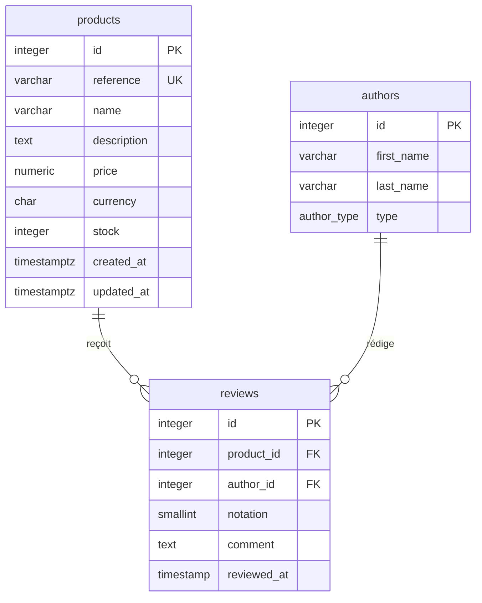

# Schéma de base de données

Ce document décrit le modèle relationnel PostgreSQL utilisé pour stocker le catalogue `data/products.json`.

Le modèle compte **3 tables** :

| Table      | Rôle                                                  |
|------------|-------------------------------------------------------|
| `products` | Produits du catalogue                                 |
| `authors`  | Auteurs des avis (personnes qui notent les produits)  |
| `reviews`  | Avis : la relation entre un produit et un auteur      |

---

## 1. Vue d'ensemble

- Un **produit** peut avoir **0 à n** avis.
- Un **auteur** peut rédiger **0 à n** avis.
- Un **avis** porte sur **un seul** produit et a **un seul** auteur.

---

## 2. Table `products`

| Colonne       | Type                                   | Contraintes                                   | Description                                   |
|---------------|----------------------------------------|-----------------------------------------------|-----------------------------------------------|
| `id`          | `INTEGER GENERATED ALWAYS AS IDENTITY` | `PRIMARY KEY`                                 | Identifiant technique                         |
| `reference`   | `VARCHAR(20)`                          | `NOT NULL`, `UNIQUE`                          | Référence métier (ex. `59033201`)             |
| `name`        | `VARCHAR(255)`                         | `NOT NULL`                                    | Nom du produit                                |
| `description` | `TEXT`                                 | `NOT NULL`                                    | Description du produit                        |
| `price`       | `NUMERIC(10,2)`                        | `NOT NULL`, `CHECK (price >= 0)`              | Prix unitaire                                 |
| `currency`    | `CHAR(3)`                              | `NOT NULL`, `DEFAULT 'EUR'`                   | Devise, code ISO 4217                         |
| `stock`       | `INTEGER`                              | `NOT NULL`, `CHECK (stock >= 0)`              | Quantité en stock                             |
| `created_at`  | `TIMESTAMPTZ`                          | `NOT NULL`, `DEFAULT now()`                   | Date de création de la ligne                  |
| `updated_at`  | `TIMESTAMPTZ`                          | `NOT NULL`, `DEFAULT now()`                   | Date de dernière modification de la ligne     |

## 3. Table `authors`

| Colonne      | Type                                            | Contraintes   | Description               |
|--------------|-------------------------------------------------|---------------|---------------------------|
| `id`         | `INTEGER GENERATED ALWAYS AS IDENTITY`          | `PRIMARY KEY` | Identifiant technique     |
| `first_name` | `VARCHAR(100)`                                  | `NOT NULL`    | Prénom                    |
| `last_name`  | `VARCHAR(100)`                                  | `NOT NULL`    | Nom                       |
| `type`       | `author_type` (ENUM `amateur`, `professional`)  | `NOT NULL`    | Profil de l'auteur        |

Contrainte composite : `UNIQUE (first_name, last_name, type)`. Elle sert à dédoublonner les auteurs pendant le seed.

## 4. Table `reviews`

| Colonne       | Type                                   | Contraintes                                                  | Description                     |
|---------------|----------------------------------------|--------------------------------------------------------------|---------------------------------|
| `id`          | `INTEGER GENERATED ALWAYS AS IDENTITY` | `PRIMARY KEY`                                                | Identifiant technique           |
| `product_id`  | `INTEGER`                              | `NOT NULL`, `FOREIGN KEY → products(id) ON DELETE CASCADE`   | Produit évalué                  |
| `author_id`   | `INTEGER`                              | `NOT NULL`, `FOREIGN KEY → authors(id) ON DELETE RESTRICT`   | Auteur de l'avis                |
| `notation`    | `SMALLINT`                             | `NOT NULL`, `CHECK (notation BETWEEN 1 AND 5)`               | Note de 1 à 5                   |
| `comment`     | `TEXT`                                 | `NOT NULL`                                                   | Commentaire                     |
| `reviewed_at` | `TIMESTAMP`                            | `NOT NULL`                                                   | Date de l'avis (sans fuseau, comme la source) |

---

## 5. Index

| Index                              | Colonnes                  | Raison                                                                                  |
|------------------------------------|---------------------------|-----------------------------------------------------------------------------------------|
| `products_reference_key`           | `products(reference)`     | Créé automatiquement par `UNIQUE`. Recherche d'un produit par sa référence.             |
| `authors_identity_key`             | `authors(first_name, last_name, type)` | Créé automatiquement par `UNIQUE`. Dédoublonnage au seed.                  |
| `reviews_product_id_notation_idx`  | `reviews(product_id, notation)` | Avis d'un produit et agrégats du dashboard (avis positifs `> 3`, moyenne `< 3`). Couvre aussi les recherches sur `product_id` seul. |
| `reviews_author_id_idx`            | `reviews(author_id)`      | Avis d'un auteur. PostgreSQL n'indexe pas les clés étrangères automatiquement.          |

---

## 6. Justification des choix

- **Normalisation (3FN).** Un auteur est une entité à part entière : il peut rédiger plusieurs avis. Un avis relie un produit et un auteur. Aucune donnée n'est dupliquée.
- **Clé technique et clé métier.** Chaque table a un `id` entier comme clé primaire, utilisé pour les jointures. La `reference` reste unique et peut être exposée par l'API. Elle est stockée en texte pour ne pas perdre d'éventuels zéros en tête.
- **`NUMERIC(10,2)` pour le prix.** On évite les erreurs d'arrondi des flottants (`REAL` / `DOUBLE PRECISION`) sur des montants.
- **ENUM `author_type`.** La liste de valeurs est fermée et le modèle est stable : *« The data model is stable »* (README).
- **`currency` en colonne, sans table dédiée.** Le jeu de données ne contient qu'une devise (`EUR`). Une table `currencies` ajouterait une jointure sans rien apporter. La colonne permet quand même de gérer d'autres devises plus tard.
- **Pas d'agrégat stocké.** La note moyenne et le nombre d'avis ne sont pas enregistrés dans `products`. On les calcule à la requête (ou avec une vue), ce qui évite les incohérences.
- **`TIMESTAMP` sans fuseau pour `reviewed_at`.** La source (`2025-04-06T02:09:10`) ne donne pas de fuseau. On garde la valeur telle quelle au lieu d'en inventer un. Au seed, la chaîne est lue en UTC (`new Date(date + 'Z')`) : lue en heure locale, elle serait décalée selon le fuseau de la machine qui lance l'API.
- **Suppression.** Supprimer un produit supprime ses avis (`CASCADE`). Un auteur qui a encore des avis ne peut pas être supprimé (`RESTRICT`).
- **Limite connue.** Un auteur est identifié par (prénom, nom, type), car la source ne fournit pas d'identifiant. Deux homonymes de même type seraient donc fusionnés. Sur le dataset actuel, les 766 auteurs sont tous distincts.

---

## 7. Correspondance JSON → tables

| Champ source (`products.json`)   | Table.colonne            |
|----------------------------------|--------------------------|
| `reference`                      | `products.reference`     |
| `name`                           | `products.name`          |
| `description`                    | `products.description`   |
| `price`                          | `products.price`         |
| `currency`                       | `products.currency`      |
| `stock`                          | `products.stock`         |
| `reviews[]`                      | une ligne par avis dans `reviews` (`product_id` → produit parent) |
| `reviews[].notation`             | `reviews.notation`       |
| `reviews[].date`                 | `reviews.reviewed_at`    |
| `reviews[].comment`              | `reviews.comment`        |
| `reviews[].author.firstName`     | `authors.first_name`     |
| `reviews[].author.lastName`      | `authors.last_name`      |
| `reviews[].author.type`          | `authors.type`           |

**Volumétrie du dataset :** 250 produits, 766 avis, 766 auteurs distincts, 0 à 10 avis par produit.

---